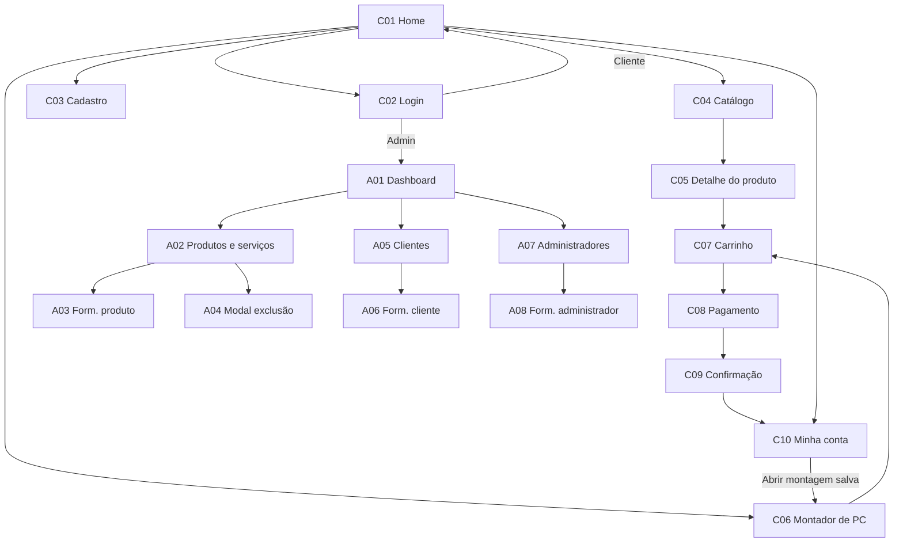

# HardwareHub: Loja Online de Hardware

Trabalho da disciplina **SCC0219 - Introduction to Web Development**.

## Identificação do grupo

| Nome                     | NUSP     |
| ------------------------ | -------- |
| Bruno Rusca Janini       | 13674917 |
| Gabriel dos Santos Alves | 14614032 |
| Leonardo Ribeiro Zanatta | 5521484  |

**Milestone atual:** 2 Funcionalidade do cliente (SPA em React consumindo um servidor simulado com json-server)

**Contas para testar** (criadas pelo seed, ver 6.3):

| Tipo          | Login (usuário ou e-mail) | Senha         |
| ------------- | ------------------------- | ------------- |
| Administrador | `admin`                   | `admin`       |
| Administrador | `admin@gmail.com`         | `Password123` |
| Cliente       | `user@gmail.com`          | `Password123` |

---

## 1. Requisitos

### 1.1 Requisitos do enunciado

- O sistema possui 2 tipos de usuário: **Clientes** e **Administradores**.
- O administrador registra e gerencia administradores, clientes e produtos/serviços. A aplicação já vem com a conta `admin`, senha `admin`.
- O cliente acessa o sistema para comprar produtos/serviços.
- Cadastro de administrador: nome, id, telefone, e-mail.
- Cadastro de cliente: nome, id, endereço, telefone, e-mail.
- Cadastro de produto/serviço: nome, id, foto, descrição, preço, quantidade em estoque e quantidade vendida.
- Venda: o cliente escolhe produtos, define a quantidade e os coloca no carrinho. O pagamento é feito com número de cartão (qualquer número é aceito). Ao pagar, o estoque diminui e a quantidade vendida aumenta. O carrinho só é esvaziado no pagamento ou pelo cliente.
- Gerenciamento: o administrador faz CRUD de produtos/serviços (inclusive alterar estoque).
- Funcionalidade própria da loja (ver 1.2).
- Acessibilidade, usabilidade e boa responsividade (tempo de resposta).

### 1.2 Requisitos específicos da nossa loja

- A loja vende **produtos** (Processador, Placa-mãe, Memória RAM, Placa de vídeo, Armazenamento, Fonte, Gabinete) e **serviços** (Montagem de PC, Instalação de sistema operacional, Limpeza e troca de pasta térmica, Upgrade de memória).
- Serviços não têm limite de estoque (exibidos como "Sob agendamento").
- Catálogo com filtros (categoria, preço, marca, disponibilidade e specs) e ordenação.
- Cada produto tem **especificações** (`specs`) que variam por categoria e são usadas nos filtros e no Montador.
- **Funcionalidade própria — Montador de PC:** o cliente escolhe uma peça por categoria; o sistema valida a compatibilidade e, se tudo estiver correto, adiciona o conjunto ao carrinho (com opção de incluir o serviço de montagem). Montagens podem ser salvas na conta do cliente. A compatibilidade é decidida por regras; uma **análise opcional com IA** explica os problemas e sugere trocas (ver 2.6).
- Login obrigatório para comprar: visitantes navegam pela loja e são levados ao login ao adicionar algo ao carrinho. Administradores não compram (não têm carrinho).
- A conta `admin` padrão não pode ser excluída, e nenhum administrador pode excluir a própria conta.
- Acessibilidade: contraste AA, rótulos visíveis nos campos, foco visível, alvos clicáveis ≥ 44 px, informação nunca só por cor (ícone + texto), texto alternativo nas imagens, navegação completa por teclado.

---

## 2. Descrição do projeto

### 2.1 Funcionalidades

Todas as funcionalidades abaixo estão implementadas e funcionando no Milestone 2.

**Visitante**

- Ver a página inicial (destaques, ofertas e serviços), o catálogo e o detalhe dos produtos.
- Usar o Montador de PC. Para adicionar ao carrinho ou salvar a montagem, precisa entrar na conta.
- Criar conta e fazer login (com e-mail ou nome de usuário).

**Cliente**

- Navegar pelo catálogo (produtos e serviços), filtrar por categoria, marca, preço e disponibilidade, ordenar e paginar. Os filtros ficam na URL, então a página pode ser recarregada ou compartilhada.
- Adicionar produtos ao carrinho escolhendo a quantidade (limitada ao estoque).
- Usar o **Montador de PC**: escolher uma peça por categoria, ver a compatibilidade em tempo real, o consumo estimado e a fonte recomendada, e adicionar todas as peças ao carrinho de uma vez (com o serviço de montagem opcional).
- Salvar montagens com um nome, reabri-las no Montador e excluí-las em "Minha conta".
- Gerenciar o carrinho (alterar quantidades, remover itens, esvaziar). O carrinho fica salvo no servidor e continua lá após sair e entrar de novo.
- Pagar com número de cartão e endereço de entrega e ver a confirmação do pedido. O estoque diminui e a quantidade vendida aumenta.
- Em "Minha conta": editar dados pessoais e endereço, trocar a senha, consultar o histórico de pedidos e as montagens salvas.

**Administrador**

- Ver o dashboard calculado a partir dos dados reais: receita, pedidos e ticket médio do mês (comparados com o mês anterior), produtos sem estoque, gráfico de receita dos últimos 7 dias e pedidos recentes.
- CRUD de produtos/serviços: lista com busca, filtros, ordenação e paginação, edição rápida de estoque, formulário com specs que mudam conforme a categoria e prévia da foto, e confirmação antes de excluir.
- CRUD de clientes.
- CRUD de administradores (a conta `admin` padrão não pode ser excluída).

### 2.2 Aplicação SPA e navegação

A aplicação segue o estilo **Single-Page Application** (React + React Router): header e footer fixos; apenas o conteúdo central (`main`) muda entre as telas, sem recarregar a página. O painel do administrador tem layout próprio, com menu lateral.



### 2.3 Mockups das telas

O mockup completo, com todas as telas, está na pasta `docs` em formato PDF: [Mockup completo (PDF)](docs/mockup.pdf). As telas implementadas em HTML5/CSS3 no Milestone 1 (abrir no navegador) estão listadas abaixo.

| ID  | Tela                     | Mockup                                   |
| --- | ------------------------ | ---------------------------------------- |
| C01 | Home (com área de login) | [HTML](mockups-html/home.html)           |
| C06 | Montador de PC           | [HTML](mockups-html/montar-pc.html)      |
| A02 | Produtos e serviços      | [HTML](mockups-html/admin-produtos.html) |

### 2.4 Telas implementadas (rotas)

| ID  | Tela                       | Rota                                           | Acesso        |
| --- | -------------------------- | ---------------------------------------------- | ------------- |
| C01 | Home                       | `/`                                            | Todos         |
| C02 | Login                      | `/login`                                       | Todos         |
| C03 | Cadastro                   | `/signup`                                      | Todos         |
| C04 | Catálogo                   | `/catalog`                                     | Todos         |
| C05 | Detalhe do produto         | `/product/:id`                                 | Todos         |
| C06 | Montador de PC             | `/monte-seu-pc`                                | Todos         |
| C07 | Carrinho                   | `/cart`                                        | Cliente       |
| C08 | Pagamento                  | `/checkout`                                    | Cliente       |
| C09 | Confirmação do pedido      | `/order/:id`                                   | Cliente       |
| C10 | Minha conta                | `/account`                                     | Cliente       |
| A01 | Dashboard                  | `/admin`                                       | Administrador |
| A02 | Produtos e serviços        | `/admin/products`                              | Administrador |
| A03 | Formulário de produto      | `/admin/products/new`, `/admin/products/:id`   | Administrador |
| A05 | Clientes                   | `/admin/clients`                               | Administrador |
| A06 | Formulário de cliente      | `/admin/clients/new`, `/admin/clients/:id`     | Administrador |
| A07 | Administradores            | `/admin/admins`                                | Administrador |
| A08 | Formulário de administrador | `/admin/admins/new`, `/admin/admins/:id`      | Administrador |
| —   | Página não encontrada      | qualquer outra rota                            | Todos         |

Quem tenta abrir uma página sem permissão é levado ao login e, depois de entrar, volta para a página que tentou abrir.

### 2.5 Informações salvas no servidor

Neste milestone o servidor é simulado com **json-server** (ver 6.3), que guarda tudo no arquivo `frontend/src/mockAPI.json`. A versão final usa um servidor Node.js com MongoDB (pasta `backend/`), com os mesmos endpoints.

- **Usuários** (`/users`, campo `type` = `"user"` ou `"admin"`):
  - Administradores: id, nome, nome de usuário, telefone, e-mail, senha.
  - Clientes: id, nome, endereço (rua, número, cidade, CEP), telefone, e-mail, senha.
- **Produtos/serviços** (`/products`): id, nome, tipo, categoria, marca, foto, descrição, preço, preço antigo (oferta), quantidade em estoque (vazia em serviços), quantidade vendida, specs.
- **Carrinhos** (`/carts`): cliente, itens e quantidades.
- **Pedidos** (`/orders`): cliente, itens (nome, preço e quantidade no momento da compra), valor total, data, últimos 4 dígitos do cartão, endereço de entrega, status.
- **Montagens salvas** (`/builds`): cliente, nome, peças escolhidas no Montador, total no dia em que foi salva e data.

No navegador (`localStorage`) ficam só a sessão do usuário logado e a montagem em andamento no Montador, para que sobrevivam a um recarregamento da página.

### 2.6 Montador de PC e análise de compatibilidade

O Montador tem 7 posições (processador, placa-mãe, memória, placa de vídeo, armazenamento, fonte e gabinete). A cada peça escolhida, a função `analyzeCompatibility()` (`frontend/src/utils/compatibility.js`) verifica as regras abaixo usando as `specs` dos produtos:

| Regra          | Verificação                                                                                 | Nível |
| -------------- | ------------------------------------------------------------------------------------------- | ----- |
| Soquete        | O soquete do processador é o mesmo da placa-mãe (ex.: AM5 com AM5)                           | Erro  |
| Memória        | O tipo da memória (DDR4/DDR5) é o suportado pela placa-mãe                                   | Erro  |
| Formato        | O gabinete aceita o formato da placa-mãe (ATX, mATX, ITX)                                    | Erro  |
| Placa de vídeo | O comprimento da placa de vídeo cabe no gabinete                                             | Erro  |
| Fonte          | A potência da fonte cobre o consumo estimado (TDP do processador + TDP da placa de vídeo + 100 W) | Erro  |
| Folga da fonte | A fonte tem a potência recomendada (consumo × 1,2, arredondado para cima de 50 em 50 W)      | Aviso |

- Um erro aparece assim que as duas peças da regra estão escolhidas, mesmo com a montagem incompleta. Se faltar um dado técnico, a regra vira aviso ("Não foi possível verificar…") em vez de adivinhar.
- O status geral aparece num painel com ícone e texto (nunca só por cor): incompleta, compatível, compatível com avisos ou incompatível.
- No seletor de cada posição, as peças compatíveis aparecem primeiro. Peças incompatíveis podem ser escolhidas (com o aviso); peças sem estoque, não.
- O botão "Adicionar configuração ao carrinho" só fica habilitado com as 7 peças, sem erros e todas com estoque. Quando está desabilitado, o motivo aparece logo abaixo dele.

O restante da aplicação chama apenas `analyzeCompatibility()`.

**Análise com IA (opcional).** Com o backend configurado com uma chave da API da Anthropic, o Montador mostra o painel "Análise com IA". Ao clicar em "Analisar com IA", o backend (`POST /builds/analyze`, em `backend/src/ai/buildAnalysis.js`):

1. calcula o resultado das regras (`analyzeCompatibility`) e escolhe, com `rankOptions`, até 3 peças compatíveis e com estoque para cada posição com problema ou vazia;
2. faz **uma** chamada ao Claude (modelo `claude-opus-5-5`, resposta em JSON com formato fixo) pedindo um resumo, a explicação de cada problema e sugestões de troca;
3. descarta qualquer sugestão fora da lista de candidatas e qualquer explicação de problema que as regras não apontaram.

As regras continuam decidindo: a IA não muda o status nem libera o botão de adicionar ao carrinho. Cada sugestão tem um botão "Usar esta peça", que troca a peça no Montador; se a montagem mudar, o painel avisa que a análise ficou desatualizada. A análise só roda no clique (cada uma é uma chamada paga à API). Sem a chave, ou com o json-server, o painel não aparece e o Montador funciona como antes.

### 2.7 Servidor MCP para agentes de IA (extra)

A pasta `mcp/` tem um servidor [Model Context Protocol](https://modelcontextprotocol.io), que permite a agentes de IA (Claude Code, Claude Desktop ou qualquer cliente MCP) usar a loja diretamente. Ele consulta a mesma API REST do site e importa as **mesmas regras** do Montador (`analyzeCompatibility`, `rankOptions`), então um agente e a página do Montador sempre concordam sobre o que é compatível.

O servidor tem três modos:

- **`readonly`** (padrão): buscar no catálogo, ver detalhes, listar categorias e marcas, validar uma montagem (`check_build`) e sugerir peças compatíveis (`suggest_parts`). Também oferece as regras do Montador como recurso e o prompt `montar-pc`, que pede um PC dentro de um orçamento.
- **`customer`**: o agente age como um cliente definido na configuração (nunca escolhido pelo agente) e pode usar o carrinho, salvar montagens, ver pedidos e comprar. Finalizar a compra e esvaziar o carrinho exigem duas etapas: uma prévia, que devolve um token de uso único, e a confirmação com esse token. O número do cartão vem da configuração e nunca passa pelo agente.
- **`admin`**: o agente age como um administrador definido na configuração e pode ver os indicadores do painel, consultar o estoque baixo, alterar estoques, criar, editar e excluir produtos (com a mesma validação do formulário do admin) e consultar usuários, sem senhas. Excluir um produto também exige prévia e confirmação. Criar ou excluir contas continua só no painel web.

Detalhes de uso em [mcp/README.md](mcp/README.md); o plano e as decisões estão em [docs/plano-mcp.md](docs/plano-mcp.md).

---

## 3. Comentários sobre o código

O cliente está em `frontend/` (React 19 + Vite). Organização das pastas em `frontend/src`:

| Pasta          | Conteúdo                                                                                                             |
| -------------- | -------------------------------------------------------------------------------------------------------------------- |
| `api/`         | Única camada que fala com o servidor. `http.js` encapsula o `fetch` (URL base, erros, query string) e os demais módulos expõem funções por recurso (`products.js`, `users.js`, `carts.js`, `orders.js`, `builds.js`, `auth.js`). |
| `pages/`       | Uma página por rota. As páginas pesadas são carregadas sob demanda (`utils/lazyPage.js`).                             |
| `components/`  | Componentes reutilizáveis, separados por área: `store/`, `builder/`, `account/`, `admin/`, `user/`.                  |
| `contexts/`    | `AuthContext` (sessão) e `CartContext` (carrinho do cliente), acessados pelos hooks `useAuth()` e `useCart()`.       |
| `hooks/`       | Lógica de tela reaproveitada (listas paginadas, confirmação de exclusão, avisos após navegação).                     |
| `utils/`       | Regras de negócio puras, sem React: compatibilidade, carrinho, pagamento, validações, filtros, estatísticas do dashboard. |
| `Layouts/`     | Layout da loja e layout do painel administrativo.                                                                    |
| `test/`        | Utilitários de teste: render com rotas reais, bancos em memória que substituem a API e a verificação com axe-core.   |

Decisões importantes:

- **Regras fora dos componentes.** A lógica de negócio fica em `utils/` como funções puras, testadas sem precisar renderizar nada. Os componentes só chamam essas funções e mostram o resultado.
- **Troca de servidor sem mudar o cliente.** Todas as chamadas passam por `api/http.js`, que lê a URL do servidor de `VITE_API_URL` (padrão `http://localhost:3000`). O mesmo código funciona com o json-server e com o servidor Node.js da versão final.
- **Pagamento com desfazer.** O json-server não tem transações. `utils/checkout.js` (`placeOrder`) confere estoque e preço de novo no momento da compra, atualiza cada produto e cria o pedido; se algum passo falhar, desfaz o que já foi alterado.
- **Ids como texto.** O json-server v1 gera ids em texto e converte filtros numéricos em números. Por isso os ids são sempre comparados como texto e os filtros por id usam `_where` (ver `whereEquals()` em `api/http.js`).
- **Estado na URL.** Filtros e páginas do catálogo e das listas do administrador ficam na query string.
- Os arquivos com regras menos óbvias têm um comentário no topo explicando o que fazem e por quê.
- Código formatado e verificado com ESLint (`npm run lint`).

---

## 4. Plano de testes

Os testes são de três tipos: automáticos (unitários e de integração), de acessibilidade e um roteiro manual no navegador.

### 4.1 Testes automáticos (Vitest + React Testing Library)

Ficam ao lado do código testado (`*.test.js` e `*.test.jsx`) e rodam com `npm run test:run` (ver 6.5). As chamadas ao servidor são substituídas por bancos em memória (`src/test/mockStore.js`, `productStore.js`, `userStore.js`), então os testes não precisam do json-server rodando.

| Área                         | O que é testado                                                                                                                   | Arquivos |
| ---------------------------- | --------------------------------------------------------------------------------------------------------------------------------- | -------- |
| Regras de negócio            | Compatibilidade do Montador, carrinho, pagamento com desfazer, validações (senha, telefone, CEP, cartão), formulários, filtros, estatísticas do dashboard | `utils/*.test.js` |
| Camada de API                | Montagem das URLs e filtros, tratamento de erros HTTP e de rede, login por e-mail ou usuário                                       | `api/*.test.js` |
| Sessão e carrinho            | Sessão salva e restaurada, logout, carrinho sincronizado com o servidor                                                           | `contexts/*.test.jsx` |
| Páginas e fluxos completos   | Cada página renderizada com as rotas reais e usada como um usuário (cliques e digitação): catálogo, produto, carrinho, pagamento, conta, Montador, CRUDs do administrador, dashboard | `pages/*.test.jsx`, `components/**/*.test.jsx` |
| Permissões e layout          | Rotas protegidas por tipo de usuário, página 404, título da aba, link "pular para o conteúdo", menu do admin no celular            | `RequireAuth.test.jsx`, `Layouts/layouts.test.jsx` |
| Dados iniciais               | O `seed.json` tem as contas obrigatórias, ids únicos e specs completas para o Montador                                            | `seed.test.js` |

Alguns testes reproduzem as demonstrações completas, por exemplo:

- **`BuilderCart.test.jsx`:** montar um PC válido, adicioná-lo ao carrinho com montagem, pagar e conferir estoque −1 e vendidos +1 em cada peça.
- **`AdminUsers.test.jsx`:** criar um administrador, sair, entrar como ele e excluir um cliente.
- **`SavedBuilds.test.jsx`:** salvar uma montagem, limpar o Montador, sair, entrar e reabri-la pela Minha conta.

### 4.2 Testes de acessibilidade (axe-core)

`src/a11y.test.jsx` renderiza 20 rotas (todas as telas da loja e do painel, incluindo as duas páginas 404) com dados realistas, além de 3 estados que só aparecem após uma ação (seletor de peças do Montador aberto, modal de exclusão, mensagem de erro do login), e verifica cada um com o **axe-core**. Roda com `npm run test:a11y`.

O que o axe-core não cobre (navegação só com teclado, foco visível, layout em 1440 px e 390 px) é verificado no teste 15 do roteiro manual (4.3).

### 4.3 Roteiro de testes manuais

Executar no navegador com `npm run dev:all`, partindo dos dados iniciais (`npm run mock:reset`). Os resultados ficam em 5.4.

| #  | Teste                         | Passos                                                                                                  | Resultado esperado                                                                        |
| -- | ----------------------------- | ------------------------------------------------------------------------------------------------------- | ----------------------------------------------------------------------------------------- |
| 1  | Cadastro de cliente           | Em `/signup`, preencher os dados com uma senha fraca; depois com uma senha forte                         | Senha fraca é recusada com mensagem; com senha forte a conta é criada e o usuário é levado ao login, onde consegue entrar |
| 2  | Login e sessão                | Entrar com `user@gmail.com` / `Password123` e recarregar a página                                       | Continua logado; o nome aparece no header                                                |
| 3  | Proteção de rotas             | Sem login, abrir `/cart`; logado como cliente, abrir `/admin`                                            | Vai para o login; o cliente não acessa o painel                                           |
| 4  | Catálogo                      | Filtrar por Placa de vídeo, marca NVIDIA, preço máximo e "em estoque"; ordenar por preço; recarregar     | Só aparecem produtos que atendem aos filtros; os filtros continuam após recarregar        |
| 5  | Carrinho                      | Adicionar dois produtos, mudar quantidades, tentar passar do estoque, remover um item                    | Totais atualizam; não passa do estoque; o contador do header acompanha                    |
| 6  | Pagamento                     | Pagar com qualquer número de cartão                                                                      | Tela de confirmação; carrinho vazio; estoque diminui e vendidos aumentam no admin         |
| 7  | Esvaziar carrinho             | Adicionar itens e clicar em "Esvaziar", sair e entrar de novo                                            | O carrinho só esvazia nesse clique ou no pagamento; nos outros casos continua salvo       |
| 8  | Montador: incompatibilidade   | Escolher Intel Core i5-14600K (LGA1700) e a placa ASUS B650M (AM5)                                       | Painel mostra "incompatível" com o motivo; botão de adicionar desabilitado                |
| 9  | Montador: compra              | Montar um PC compatível com as 7 peças, marcar a montagem e adicionar ao carrinho; pagar                  | Todas as peças e o serviço vão para o carrinho; a compra conclui                           |
| 10 | Montagens salvas              | Salvar uma montagem, sair, entrar e abri-la em Minha conta                                               | A montagem volta para o Montador com as mesmas peças                                      |
| 11 | Minha conta                   | Editar o endereço, trocar a senha e ver o histórico de pedidos                                          | Dados salvos; o novo pedido aparece no histórico                                          |
| 12 | Admin: produtos               | Entrar como `admin` / `admin`; criar um produto, vê-lo no catálogo, alterar o estoque e excluí-lo        | Cada operação aparece na loja; a exclusão pede confirmação                                 |
| 13 | Admin: clientes e admins      | Criar um admin, entrar com ele, excluir um cliente; tentar excluir a conta `admin`                       | Operações funcionam; a conta `admin` e a própria conta não podem ser excluídas            |
| 14 | Admin: dashboard              | Fazer um pedido como cliente e abrir o dashboard                                                         | Receita, pedidos e gráfico incluem o novo pedido                                          |
| 15 | Teclado e celular             | Fazer o fluxo de compra só com teclado; repetir com a janela em 390 px                                   | Tudo alcançável e com foco visível; layout sem rolagem horizontal                         |

---

## 5. Resultados dos testes

### 5.1 Testes automáticos

Saída de `npm run test:run` no frontend (26/11/2026, já com o painel de análise com IA):

```
 Test Files  41 passed (41)
      Tests  508 passed (508)
```

| Grupo                                   | Testes |
| --------------------------------------- | -----: |
| Regras de negócio (`utils/`)            |    241 |
| Páginas e componentes                   |    170 |
| Camada de API (`api/`)                  |     38 |
| Acessibilidade (`a11y.test.jsx`)        |     23 |
| Contextos (sessão e carrinho)           |     16 |
| Layouts (404, título, skip link, menu)  |     11 |
| Dados iniciais (`seed.test.js`)         |      9 |
| **Total**                               | **508** |

Fora do frontend: `npm test` no `backend/` roda 5 testes da análise com IA (com um cliente falso da API da Anthropic, sem rede nem custo) e `npm run test:run` no `mcp/` roda 89 testes do servidor MCP.

### 5.2 Acessibilidade

- `npm run test:a11y`: 23 de 23 testes passando, **nenhuma violação do axe-core** nas 20 rotas e nos 3 estados interativos.
- Problemas encontrados e corrigidos durante os testes: página sem idioma e sem título, rodapé e menu do admin sem landmark (`<footer>`/`<header>`), botão de fechar mensagem sem nome acessível, hierarquia de títulos nas telas de login e cadastro, e um verde com contraste abaixo de AA nas mensagens de sucesso.

### 5.3 Qualidade e build

- `npm run lint`: nenhum erro ou aviso.
- `npm run build`: build gerado com sucesso. Com o carregamento sob demanda das páginas, o arquivo JavaScript principal caiu de ~600 kB para 356 kB (112 kB com gzip).

### 5.4 Roteiro manual

Executado em 26/11/2026 em um navegador baseado em Chromium, a partir dos dados iniciais (`npm run mock:reset`) e com o json-server rodando. Depois de cada ação, os dados gravados foram conferidos no `mockAPI.json`.

| #  | Teste                       | Resultado | O que foi observado |
| -- | --------------------------- | --------- | ------------------- |
| 1  | Cadastro de cliente         | OK        | A senha "fraca" foi recusada ("A senha deve ter no mínimo 8 caracteres"). Com senha forte, apareceu "Cadastro realizado com sucesso!", o usuário foi levado ao login e conseguiu entrar ("Olá, Teste"). |
| 2  | Login e sessão              | OK        | Login com `user@gmail.com`; após recarregar a página, o header continua mostrando "Olá, Ana". |
| 3  | Proteção de rotas           | OK        | Visitante em `/cart` foi levado ao login e, depois de entrar, voltou para `/cart`. Cliente em `/admin` foi levado para a home. |
| 4  | Catálogo                    | OK, com 1 problema | Placa de vídeo + NVIDIA + até R$ 5.000 + somente disponíveis trouxe só a RTX 4070 SUPER (a RTX 4080 passa do preço). Menor preço ordenou RX 7600 → RTX 4070 → RTX 4080. Os filtros ficam na URL e os resultados continuam certos após recarregar, **mas o campo "Marca" volta a mostrar "Todas"** (ver Problemas encontrados). |
| 5  | Carrinho                    | OK        | O botão "+" para no estoque (3 do Ryzen 7 7800X3D), e digitar 99 no campo vira 3. Subtotais, total e contador do header acompanham as mudanças; remover item funciona. |
| 6  | Pagamento                   | OK        | Pagamento com qualquer número aceito; tela "Pedido confirmado!" com "Cartão terminado em 3456". Estoque do produto foi de 3 para 0 e vendidos de 42 para 45; carrinho vazio; só os 4 últimos dígitos foram salvos. |
| 7  | Esvaziar carrinho           | OK        | O carrinho continuou salvo depois de sair e entrar. "Esvaziar carrinho" pede confirmação e só então esvazia. |
| 8  | Montador: incompatibilidade | OK        | Core i5-14600K + ASUS B650M: "Há peças incompatíveis" e "Soquete incompatível: o processador é LGA1700 e a placa-mãe é AM5." Botão de adicionar desabilitado. |
| 9  | Montador: compra            | OK        | Ryzen 5 7600, B650M, DDR5, RX 7600, 990 Pro, CX650 e Lancool 216: "Configuração compatível", consumo 330 W, fonte recomendada 400 W. As 7 peças e a montagem foram para o carrinho (R$ 7.449,20) e a compra concluiu; cada peça teve estoque −1 e vendidos +1, e o serviço teve vendidos +1. |
| 10 | Montagens salvas            | OK        | "PC do roteiro" salvo; depois de limpar o Montador, sair e entrar, "Abrir no montador" trouxe as mesmas 7 peças. |
| 11 | Minha conta                 | OK        | "Dados atualizados com sucesso" (número do endereço salvo) e "Senha alterada com sucesso" (o login seguinte usou a senha nova). Os dois pedidos aparecem no histórico, do mais novo ao mais antigo. |
| 12 | Admin: produtos             | OK        | Produto criado com specs de periférico, apareceu na busca da loja, estoque alterado de 5 para 12 pela lista e excluído após o diálogo de confirmação. |
| 13 | Admin: clientes e admins    | OK        | Admin criado e usado para entrar; cliente de teste excluído com confirmação. A conta `admin` mostra "A conta padrão 'admin' não pode ser excluída" e a própria conta mostra "Você não pode excluir a própria conta". |
| 14 | Admin: dashboard            | OK        | Depois dos pedidos do cliente, o dashboard mostrou receita de R$ 14.948,90 (soma dos dois pedidos), 2 pedidos, 4 produtos sem estoque e os dois pedidos em "Pedidos recentes". |
| 15 | Teclado e celular           | OK        | Compra completa só com teclado (link "Pular para o conteúdo", Tab, Enter), com contorno de foco visível. Em 390 px nenhuma página da loja ou do painel rola na horizontal (tabelas rolam dentro do próprio quadro) e o botão "Menu" do painel abre a navegação. |

**Problemas encontrados**

- **Filtro de marca após recarregar (teste 4):** com `brand=NVIDIA` na URL, os resultados são filtrados corretamente, mas o seletor "Marca" mostra "Todas". Causa: o `<select>` não é controlado e a opção da marca é recriada quando a lista de marcas termina de carregar, perdendo a seleção inicial (`frontend/src/pages/Catalog.jsx`).
- **Telefone sem formatação (teste 13, menor):** um telefone digitado sem máscara (ex.: `16988887777`) é salvo e exibido assim, enquanto os do seed aparecem como `(16) 3373-0000`.

**Não coberto por este roteiro:** testes no Firefox e no Edge.

---

## 6. Procedimentos de build

**Pré-requisitos:** [Git](https://git-scm.com/), [Node.js](https://nodejs.org/) 20.19 ou mais recente (testado com o 24) e npm. Os comandos abaixo funcionam no terminal do Windows, Linux e macOS.

### 6.1 Mockups em HTML (Milestone 1)

Para visualizar os mockups estáticos:

1. Clone o repositório: `git clone https://github.com/brunorjanini/scc0219_hardwarehub`
2. Entre na pasta: `cd scc0219_hardwarehub/mockups-html`
3. Abra o arquivo `home.html` em um navegador (Chrome, Firefox ou Edge).

As demais telas estão no PDF do mockup completo em `docs/`.

### 6.2 Instalação do cliente (Milestone 2)

```bash
git clone https://github.com/brunorjanini/scc0219_hardwarehub
cd scc0219_hardwarehub/frontend
npm install
```

### 6.3 Executar a aplicação

Dentro de `frontend/`:

```bash
npm run mock:reset   # restaura os dados iniciais (produtos e contas de teste)
npm run dev:all      # sobe o json-server (porta 3000) e o site (porta 5173) juntos
```

Abra **http://localhost:5173** no navegador e entre com uma das contas do início deste documento (por exemplo, `admin` / `admin`).

Se preferir usar dois terminais, rode `npm run mock:server` em um e `npm run dev` no outro.

Sobre o servidor simulado:

- A API fica em `http://localhost:3000`. Cada chave de primeiro nível do `mockAPI.json` vira um endpoint (por exemplo, `GET /products`, `GET /users?email=ana@email.com`).
- Tudo o que é feito na loja (`POST`, `PUT`, `PATCH`, `DELETE`) é gravado diretamente no `frontend/src/mockAPI.json`.
- `npm run mock:reset` copia `src/seed.json` por cima do `mockAPI.json`, voltando aos dados iniciais. Use antes de uma demonstração.

### 6.4 Build de produção

```bash
npm run build     # gera os arquivos otimizados em frontend/dist (com o index.html)
npm run preview   # serve o build em http://localhost:4173 para conferência
```

O json-server (`npm run mock:server`) precisa estar rodando também para o build funcionar com dados. Para apontar o cliente para outro servidor, crie `frontend/.env` com `VITE_API_URL=http://host:porta` antes do build.

### 6.5 Rodar os testes

```bash
npm run test:run   # todos os testes automáticos (não precisa do json-server)
npm run test:a11y  # só os testes de acessibilidade
npm run lint       # verificação de código com ESLint
```

### 6.6 Servidor Node.js + MongoDB (versão final, em desenvolvimento)

A pasta `backend/` tem o servidor da versão final (Express + MongoDB), que substitui o json-server com os mesmos endpoints. As instruções estão em [backend/README.md](backend/README.md). Ele também usa a porta 3000, então não rode o json-server ao mesmo tempo.

Para ligar a **análise com IA** do Montador (opcional), coloque uma chave da API da Anthropic em `ANTHROPIC_API_KEY`, no arquivo `backend/.env`, e reinicie o backend. Cada clique em "Analisar com IA" é uma chamada cobrada nessa chave. Sem a chave, o painel não aparece.

### 6.7 Servidor MCP (opcional)

Com a API rodando (6.3 ou 6.6):

```bash
cd mcp
npm install
npm run test:run   # testes automáticos (não precisam da API)
npm run smoke      # verificação de ponta a ponta contra a API
npm run inspect    # abre o MCP Inspector no navegador para chamar as ferramentas
```

No Claude Code, o arquivo `.mcp.json` da raiz já registra o servidor: basta aprová-lo ao abrir o projeto. Outras opções em [mcp/README.md](mcp/README.md).

---

## 7. Problemas

- **Senhas em texto puro e sem autenticação real.** O json-server não tem autenticação: o login compara a senha no cliente, e as senhas ficam salvas sem criptografia. Isso foi aceito para o servidor simulado.
- **Sem transações no json-server.** Duas compras simultâneas das últimas unidades de um produto podem passar as duas. O pagamento revalida o estoque e desfaz alterações em caso de erro (ver 3), mas a garantia completa depende do servidor da versão final.
- **Particularidades do json-server v1.** Ele gera ids em texto e converte filtros com cara de número em números, o que fazia filtros por id não encontrarem nada; o `PATCH` substitui objetos internos inteiros (como `address` e `specs`). Resolvemos com o filtro `_where` e enviando os objetos completos.
- **Dados de teste no `mockAPI.json`.** Como o json-server grava tudo nesse arquivo, usar a loja altera o arquivo do repositório. Criamos o `npm run mock:reset` para restaurar os dados iniciais.
- **Bundle grande.** O build avisava que o JavaScript passava de 500 kB. Resolvido carregando as páginas sob demanda (code splitting).
- **Teste instável.** Um teste de carrinho estourava o tempo de espera padrão (1 s) quando a máquina estava carregada. Aumentamos o tempo de espera dos testes para 3 s.

## 8. Comentários

- O plano de implementação do Milestone 2, com as decisões tomadas em cada etapa, está em [docs/plano-milestone2.md](docs/plano-milestone2.md).
- Fotos de produtos são informadas pelo caminho da imagem (`/products/arquivo.jpg`), porque o json-server não aceita upload de arquivos. Produtos sem foto usam uma imagem padrão da categoria.
