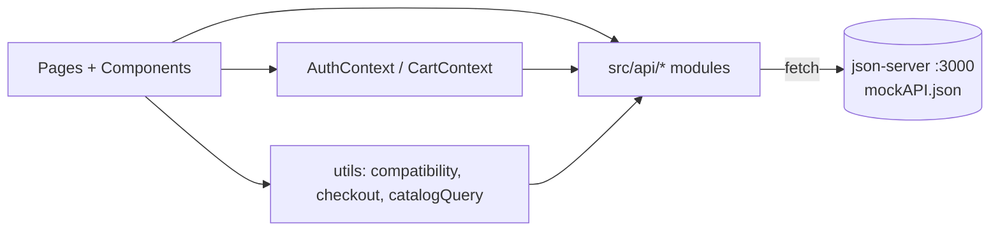
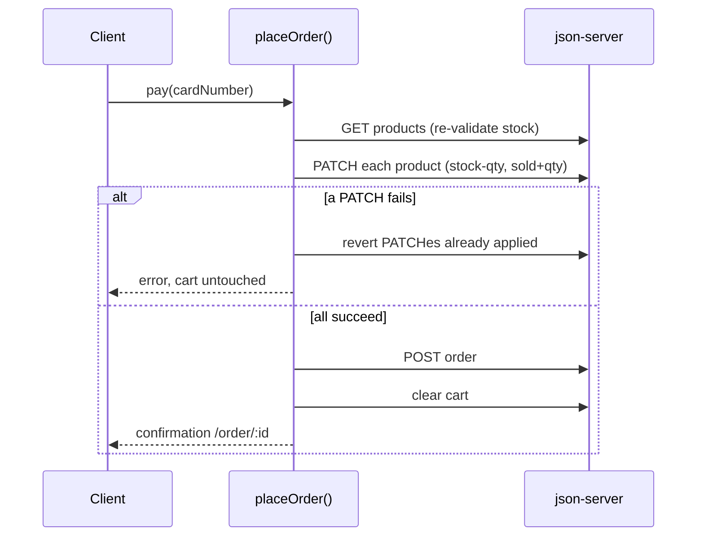

# Implementation Plan: Finish Milestone 2 (HardwareHub client)

## Progress

- [x] 1. Test tooling, API layer, seed data
- [x] 2. Auth completion and route guards
- [x] 3. Home, Catalog, Product Detail, Cart state
- [x] 4. Cart page, Checkout, Order confirmation
- [ ] 5. My Account
- [ ] 6. Admin Products CRUD
- [ ] 7. Admin Clients and Admins CRUD
- [ ] 8. Compatibility engine and Builder page
- [ ] 9. Builder summary and Add to Cart
- [ ] 10. (stretch) Dashboard from real data
- [ ] 11. (stretch) Saved builds
- [ ] 12. Accessibility, responsiveness, quality pass
- [ ] 13. Docs, test script, build verification

## Problem Statement

The React client has working login only. Milestone 2 requires every client interface and feature to respond to user input, backed by a mock server: storefront, catalog, cart, payment, account, admin CRUD, and the PC Builder, plus a Test Plan with results and Build Procedures.

## Decisions

| Area | Decision |
|---|---|
| Backend | json-server v1 only. Add `npm run dev:all` (server + Vite) and `npm run mock:reset` (restore `seed.json`). |
| PC Builder | Rule-based check behind one `analyzeCompatibility(parts)` function. AI call deferred to the final version. |
| Admin login | Accepts email or username. Seed account `admin` / `admin`. Password-strength rule applies at sign-up only. |
| Catalog | About 30 products, reusing the 5 existing images plus one placeholder per category. Stored in `mockAPI.json`, editable through admin CRUD. |
| Cart | Per user on the server (`/carts`). Login required to add items. |
| Scope | Core CRUD (products, clients, admins) and My Account (profile, orders). Stretch: dashboard from real orders, saved builds. |
| Extra fixes | Session persistence, route guards, the `"sucess"` typo, the missing `return` in `UserLogin`. |
| Tests | Vitest + React Testing Library, plus a written manual test script in the README. |
| Spec items | Admin: name, id, phone, email. Client: name, id, address, phone, email. Product: name, id, photo, description, price, stock, sold. Any card number accepted. Stock decreases and sold increases on payment. Cart emptied only on payment or by the customer. |

## Background

- `main.jsx` defines only `/`, `/login` and four `/admin/*` routes. The index route is the sign-up page. `UserHeader` links to `/monte-seu-pc`, which has no route.
- `mockAPI.json` had two users with numeric ids. json-server v1 creates **string ids**, uses `field:op=value` filters (`price:lte=500`, `name:contains=ryzen`) and `_page` / `_per_page` pagination. The data layer compares ids as strings.
- json-server writes to `mockAPI.json`, so a pristine `seed.json` is needed for resets.
- The HTML mockup says "8 componentes"; the README names 7 categories. The plan uses 7 (CPU, motherboard, RAM, GPU, storage, PSU, case).
- Plaintext passwords are acceptable for a mock only. List under "Problems", with hashing planned for the Node server.

## Architecture

**Routes:** `/` Home, `/login`, `/signup`, `/catalog`, `/product/:id`, `/cart`, `/checkout`, `/order/:id`, `/account`, `/monte-seu-pc`, `/admin`, `/admin/products` (+ `/new`, `/:id`), `/admin/clients` (+ forms), `/admin/admins` (+ forms). `RequireAuth` guards `/cart`, `/checkout`, `/order/:id`, `/account`. `RequireAdmin` guards `/admin/*`.

**Collections:**

- `users`: `{id, type: "user"|"admin", name, username?, email, password, phone, address{street, number, city, zip}}`
- `products`: `{id, name, type: "product"|"service", category, brand, photo, description, price, stock (null for services), sold, specs{}}`
- `carts`: `{id, userId, items:[{productId, quantity}]}`
- `orders`: `{id, userId, items:[{productId, name, price, quantity}], total, date, cardLast4, address, status}`
- `builds` (stretch): `{id, userId, name, parts{category: productId}, total}`

**Seed catalog (~30):** 4 CPUs (AM5 ×2, AM4, LGA1700), 4 motherboards (matching sockets, DDR4/DDR5), 4 RAM kits, 3 GPUs, 3 storage drives, 3 PSUs (550/650/850 W), 3 cases (one small with a short GPU limit), 2 peripherals, 4 services.

**Compatibility rules (`analyzeCompatibility`):**

- Error: CPU socket ≠ board socket; RAM type unsupported by board; board form factor unsupported by case; GPU length > case maximum; PSU watts < estimated draw.
- Warning: PSU watts < 1.2 × estimated draw.
- Estimated draw = CPU TDP + GPU TDP + 100 W.
- Returns `{status: "incomplete"|"ok"|"warning"|"error", issues[], estimatedWatts, recommendedWatts}`.

**Checkout consistency (json-server has no transactions):**

**Test strategy:** API modules tested with mocked `fetch`; pages tested with mocked `api/` modules and user-event; compatibility table with 12+ cases; checkout success, insufficient stock and rollback. Each task adds its own tests.

## Tasks

| # | Task | Demo |
|---|---|---|
| 1 | **Test tooling, API layer, seed data.** Vitest, jsdom, RTL, user-event, concurrently. Scripts `test`, `test:run`, `dev:all`, `mock:reset`. `src/api/http.js` + `products/users/carts/orders.js`. `seed.json` with `admin`/`admin`, a sample client, ~30 products; images in `public/products/`. Refactor existing fetches. | `dev:all` serves `/products`; tests green; reset works |
| 2 | **Auth completion and guards.** Email-or-username login; session in localStorage; sign-up POSTs; sign-up moves to `/signup`; `RequireAuth` / `RequireAdmin`; logout + name in header; fix typo and missing `return`. | Register, log in, refresh, still logged in; `/admin` only for admins |
| 3 | **Home, Catalog, Product Detail, Cart state.** Port `home.html`; `/catalog` with filters, sorting, pagination; `ProductCard`; `/product/:id`; `CartContext` on `/carts`; guest redirect to login; cart badge; fix dead header links. | Filter, open product, add to cart, badge persists after refresh |
| 4 | **Cart, Checkout, Confirmation.** `/cart` controls and "Esvaziar"; `/checkout` with address + any card (store last 4); `placeOrder` with rollback; `/order/:id`. | Buy two products; stock and sold updated |
| 5 | **My Account.** Profile form, password change, order history and detail. | Edit address, see new order in history |
| 6 | **Admin Products CRUD.** List with search/filters/pagination and quick stock edit; create/edit forms with category-dependent specs and photo preview; delete modal; services without stock. | Create product, see it in catalog, edit stock, delete |
| 7 | **Admin Clients and Admins CRUD.** Shared table/form by `type`; unique email/username; default `admin` undeletable; no self-delete. | Create admin, log in as them, delete a client |
| 8 | **Compatibility engine and Builder page.** `analyzeCompatibility` test-first; `/monte-seu-pc` with 7 slots, pickers, status banner (icon + text), per-part warnings. | AM5 CPU + LGA1700 board shows error; fix shows "compatível" |
| 9 | **Builder summary and Add to Cart.** Total, wattage, optional assembly service; button enabled only when complete and error-free; adds all parts to cart. | Build valid PC, add, check out, stock decreases |
| 10 | *(stretch)* **Dashboard from real data.** `dashboardStats` util; real cards and chart; recent orders. | Order changes dashboard numbers |
| 11 | *(stretch)* **Saved builds.** Save to `/builds`; list, load and delete in My Account; flag deleted products. | Save, log out/in, reload build |
| 12 | **Accessibility, responsiveness, quality.** AA contrast, focus, 44 px targets, labels, alt text, `aria-live`, keyboard modals; 1440 px and 390 px; loading/error states; 404; ESLint clean; jest-axe smoke tests. | Whole purchase flow by keyboard and at phone width |
| 13 | **Docs, test script, build verification.** README: status, functionalities, server data, code comments, Test Plan, Test Results (`test:run` output + manual table), Build Procedures (incl. `build` + `preview`), Problems, `admin`/`admin` credentials. Verify on a clean clone. | Reviewer can clone, run, buy, and edit as admin |

**If time is short:** Tasks 1–9 and 12–13 cover every spec requirement. Tasks 10 and 11 can be dropped.
