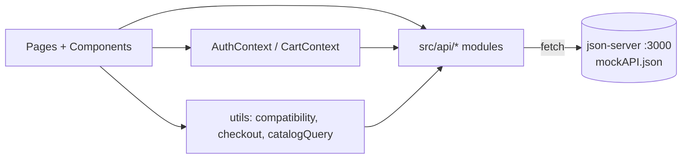
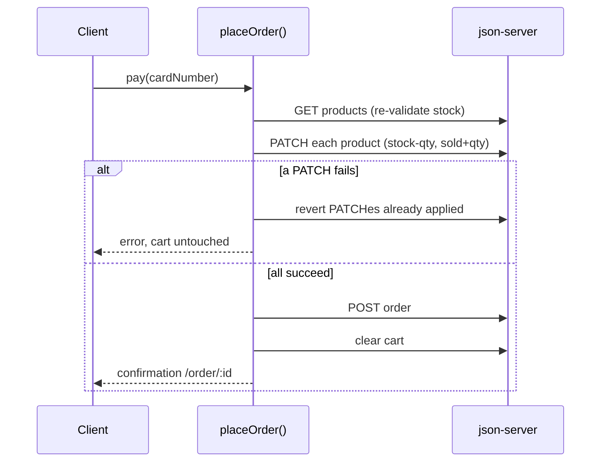

# Implementation Plan: Finish Milestone 2 (HardwareHub client)

## Progress

- [x] 1. Test tooling, API layer, seed data
- [x] 2. Auth completion and route guards
- [x] 3. Home, Catalog, Product Detail, Cart state
- [x] 4. Cart page, Checkout, Order confirmation
- [x] 5. My Account
- [x] 6. Admin Products CRUD
- [x] 7. Admin Clients and Admins CRUD
- [x] 8. Compatibility engine and Builder page
- [x] 9. Builder summary and Add to Cart
- [x] 10. (stretch) Dashboard from real data
- [ ] 11. (stretch) Saved builds
- [ ] 12. Accessibility, responsiveness, quality pass
- [ ] 13. Docs, test script, build verification

## Problem Statement

The React client has working login only. Milestone 2 requires every client interface and feature to respond to user input, backed by a mock server: storefront, catalog, cart, payment, account, admin CRUD, and the PC Builder, plus a Test Plan with results and Build Procedures.

## Decisions

| Area | Decision |
|---|---|
| Backend | json-server v1 only. Add `npm run dev:all` (server + Vite) and `npm run mock:reset` (restore `seed.json`). |
| PC Builder | Rule-based check behind one `analyzeCompatibility(parts)` function. AI call deferred to the final version. |
| Admin login | Accepts email or username. Seed account `admin` / `admin`. Password-strength rule applies at sign-up only. |
| Catalog | About 30 products, reusing the 5 existing images plus one placeholder per category. Stored in `mockAPI.json`, editable through admin CRUD. |
| Cart | Per user on the server (`/carts`). Login required to add items. |
| Scope | Core CRUD (products, clients, admins) and My Account (profile, orders). Stretch: dashboard from real orders, saved builds. |
| Extra fixes | Session persistence, route guards, the `"sucess"` typo, the missing `return` in `UserLogin`. |
| Tests | Vitest + React Testing Library, plus a written manual test script in the README. |
| Spec items | Admin: name, id, phone, email. Client: name, id, address, phone, email. Product: name, id, photo, description, price, stock, sold. Any card number accepted. Stock decreases and sold increases on payment. Cart emptied only on payment or by the customer. |

## Background

- `main.jsx` defines only `/`, `/login` and four `/admin/*` routes. The index route is the sign-up page. `UserHeader` links to `/monte-seu-pc`, which has no route.
- `mockAPI.json` had two users with numeric ids. json-server v1 creates **string ids**, uses `field:op=value` filters (`price:lte=500`, `name:contains=ryzen`) and `_page` / `_per_page` pagination. The data layer compares ids as strings.
- json-server writes to `mockAPI.json`, so a pristine `seed.json` is needed for resets.
- The HTML mockup says "8 componentes"; the README names 7 categories. The plan uses 7 (CPU, motherboard, RAM, GPU, storage, PSU, case).
- Plaintext passwords are acceptable for a mock only. List under "Problems", with hashing planned for the Node server.

## Architecture

**Routes:** `/` Home, `/login`, `/signup`, `/catalog`, `/product/:id`, `/cart`, `/checkout`, `/order/:id`, `/account`, `/monte-seu-pc`, `/admin`, `/admin/products` (+ `/new`, `/:id`), `/admin/clients` (+ forms), `/admin/admins` (+ forms). `RequireAuth` guards `/cart`, `/checkout`, `/order/:id`, `/account`. `RequireAdmin` guards `/admin/*`.

**Collections:**

- `users`: `{id, type: "user"|"admin", name, username?, email, password, phone, address{street, number, city, zip}}`
- `products`: `{id, name, type: "product"|"service", category, brand, photo, description, price, stock (null for services), sold, specs{}}`
- `carts`: `{id, userId, items:[{productId, quantity}]}`
- `orders`: `{id, userId, items:[{productId, name, price, quantity}], total, date, cardLast4, address, status}`
- `builds` (stretch): `{id, userId, name, parts{category: productId}, total}`

**Seed catalog (~30):** 4 CPUs (AM5 ×2, AM4, LGA1700), 4 motherboards (matching sockets, DDR4/DDR5), 4 RAM kits, 3 GPUs, 3 storage drives, 3 PSUs (550/650/850 W), 3 cases (one small with a short GPU limit), 2 peripherals, 4 services.

**Compatibility rules (`analyzeCompatibility`):**

- Error: CPU socket ≠ board socket; RAM type unsupported by board; board form factor unsupported by case; GPU length > case maximum; PSU watts < estimated draw.
- Warning: PSU watts < 1.2 × estimated draw.
- Estimated draw = CPU TDP + GPU TDP + 100 W.
- Returns `{status: "incomplete"|"ok"|"warning"|"error", issues[], estimatedWatts, recommendedWatts}`.

**Checkout consistency (json-server has no transactions):**

**Test strategy:** API modules tested with mocked `fetch`; pages tested with mocked `api/` modules and user-event; compatibility table with 12+ cases; checkout success, insufficient stock and rollback. Each task adds its own tests.

## Tasks

| # | Task | Demo |
|---|---|---|
| 1 | **Test tooling, API layer, seed data.** Vitest, jsdom, RTL, user-event, concurrently. Scripts `test`, `test:run`, `dev:all`, `mock:reset`. `src/api/http.js` + `products/users/carts/orders.js`. `seed.json` with `admin`/`admin`, a sample client, ~30 products; images in `public/products/`. Refactor existing fetches. | `dev:all` serves `/products`; tests green; reset works |
| 2 | **Auth completion and guards.** Email-or-username login; session in localStorage; sign-up POSTs; sign-up moves to `/signup`; `RequireAuth` / `RequireAdmin`; logout + name in header; fix typo and missing `return`. | Register, log in, refresh, still logged in; `/admin` only for admins |
| 3 | **Home, Catalog, Product Detail, Cart state.** Port `home.html`; `/catalog` with filters, sorting, pagination; `ProductCard`; `/product/:id`; `CartContext` on `/carts`; guest redirect to login; cart badge; fix dead header links. | Filter, open product, add to cart, badge persists after refresh |
| 4 | **Cart, Checkout, Confirmation.** `/cart` controls and "Esvaziar"; `/checkout` with address + any card (store last 4); `placeOrder` with rollback; `/order/:id`. | Buy two products; stock and sold updated |
| 5 | **My Account.** Profile form, password change, order history and detail. | Edit address, see new order in history |
| 6 | **Admin Products CRUD.** List with search/filters/pagination and quick stock edit; create/edit forms with category-dependent specs and photo preview; delete modal; services without stock. | Create product, see it in catalog, edit stock, delete |
| 7 | **Admin Clients and Admins CRUD.** Shared table/form by `type`; unique email/username; default `admin` undeletable; no self-delete. | Create admin, log in as them, delete a client |
| 8 | **Compatibility engine and Builder page.** `analyzeCompatibility` test-first; `/monte-seu-pc` with 7 slots, pickers, status banner (icon + text), per-part warnings. | AM5 CPU + LGA1700 board shows error; fix shows "compatível" |
| 9 | **Builder summary and Add to Cart.** Total, wattage, optional assembly service; button enabled only when complete and error-free; adds all parts to cart. | Build valid PC, add, check out, stock decreases |
| 10 | *(stretch)* **Dashboard from real data.** `dashboardStats` util; real cards and chart; recent orders. | Order changes dashboard numbers |
| 11 | *(stretch)* **Saved builds.** Save to `/builds`; list, load and delete in My Account; flag deleted products. | Save, log out/in, reload build |
| 12 | **Accessibility, responsiveness, quality.** AA contrast, focus, 44 px targets, labels, alt text, `aria-live`, keyboard modals; 1440 px and 390 px; loading/error states; 404; ESLint clean; jest-axe smoke tests. | Whole purchase flow by keyboard and at phone width |
| 13 | **Docs, test script, build verification.** README: status, functionalities, server data, code comments, Test Plan, Test Results (`test:run` output + manual table), Build Procedures (incl. `build` + `preview`), Problems, `admin`/`admin` credentials. Verify on a clean clone. | Reviewer can clone, run, buy, and edit as admin |

**If time is short:** Tasks 1–9 and 12–13 cover every spec requirement. Tasks 10 and 11 can be dropped.

## Notas para continuar

Estado após as Tasks 1–10. Leia antes de começar a próxima task.

### Ambiente (Windows desta máquina)

- O terminal falha dentro de `frontend/` por causa dos acentos no caminho. Rode tudo a partir da raiz: `npm --prefix frontend run test:run`, `... run lint`, `... run build`, `... run mock:server`, `... run mock:reset`.
- Saídas longas só aparecem quando o comando roda como processo em segundo plano.
- `npm run mock:reset` sobrescreve `frontend/src/mockAPI.json` com `seed.json`. Confira `git status` antes, para não apagar dados de teste de alguém, e rode-o antes de commitar, para não subir dados de teste.
- Contas do seed: `admin` / `admin` (admin, id "3"), `admin@gmail.com` / `Password123` (admin, id "2"), `user@gmail.com` / `Password123` (cliente Ana Souza, id "1").

### json-server v1 (armadilhas já resolvidas)

- Ele converte valores de filtro com cara de número (`?userId=1`) em números e compara com `===`, então nunca bate com o id `"1"` salvo como string. Para filtros de igualdade por id/usuário use `whereEquals()` de `api/http.js` (gera `_where`). `_where` substitui os outros filtros da URL; `_sort` e `_page` continuam valendo.
- Ids são sempre strings; compare com `sameId()`.
- PATCH faz merge raso: ao mudar `address` ou `specs`, envie o objeto inteiro.
- Filtros usados: em estoque `stock:ne=0` (serviços têm `stock: null` e passam), ofertas `oldPrice:gt=0`, seções via `category:in=...`. Veja `buildProductQuery` em `api/products.js` e `utils/catalogQuery.js`.
- Paginação (`_page`, `_per_page`) devolve `{ data, items, pages, ... }` em vez de um array.

### Modelo de dados (ver `src/seed.json`)

- `products`: `{ id, name, type: "product"|"service", category, brand, photo, description, price, oldPrice?, stock (null em serviços), sold, specs }`.
- `oldPrice` é opcional e marca o produto como oferta (precisa ser maior que `price`). O formulário de produto do admin (Task 6) deve permitir editá-lo.
- `specs` por categoria (o Montador da Task 8 depende delas):
  - cpu: `socket, cores, threads, baseClockGhz, boostClockGhz, tdp`
  - motherboard: `socket, chipset, formFactor (ATX|mATX|ITX), memoryType (DDR4|DDR5), memorySlots, maxMemoryGb`
  - ram: `memoryType, capacityGb, modules, speedMhz`
  - gpu: `vramGb, lengthMm, tdp, recommendedPsuW`
  - storage: `storageType (NVMe|HDD), capacityGb, interface`
  - psu: `watts, efficiency, modular`
  - case: `supportedFormFactors (array), maxGpuLengthMm`
  - peripheral: `kind, ...`; service: `durationHours`
- Rótulos em português das specs: `utils/specs.js`. Categorias, seções e imagens placeholder: `utils/categories.js`. Fotos ficam em `public/products/` e o campo `photo` guarda o caminho (`/products/x.jpg`); json-server não aceita upload.
- `users`: um único collection com `type: "user"|"admin"`; clientes têm `address {street, number, city, zip}`, admins têm `username`.
- `carts`: `{ id, userId, items: [{ productId, quantity }] }`; `orders`: `{ id, userId, items: [{ productId, name, price, quantity }], total, date, cardLast4, address, status: "Pago" }`.

### Código existente para reaproveitar

- API: `api/products.js` (`listProducts`, `getProduct`, `createProduct`, `updateProduct`, `deleteProduct`), `api/users.js` (`listUsers(type)`, `getUser`, `createUser`, `updateUser`, `deleteUser`, `findUsersByEmail`, `findUsersByUsername`), `api/orders.js`, `api/carts.js`.
- Regras: `utils/validators.js` (senha, telefone, CEP, cartão, troca de senha), `utils/clientForm.js` (cadastro e perfil de cliente), `utils/stock.js`, `utils/checkout.js` (`placeOrder` com rollback).
- Contextos: `useAuth()` (`user = { id, type, name }`, `login`, `logout`) e `useCart()`. Admins não compram: não têm carrinho e as páginas de compra usam `RequireAuth role="user"`; o admin usa `RequireAuth role="admin"` (já aplicado em `/admin/*` em `routes.jsx`).
- Componentes: `FormField` (input com label, prop `short`, classe `.form-row` para dois campos lado a lado), `components/store/*` (cards, imagem com fallback, selo de estoque, seletor de quantidade), `SuperiorModal` (toast).
- Estilos globais em `index.css`: `.store-page`, `.page-message` (+ `.error`), `.link-button` (+ `.secondary`, `.is-disabled`), `.visually-hidden`, e a base de `p`/`h2` (antes vazava de `TopBar.css`). Escopo de CSS: não use seletores soltos como `button`, `nav`, `ul` ou `main`; eles já quebraram outras páginas.
- O admin ainda usa os estilos originais (`AdminLayout.css`, `TopBar`, `DashboardCard`).

### Admin de produtos (Task 6)

- Páginas: `pages/AdminProducts.jsx` (lista) e `pages/AdminProductForm.jsx` (`/admin/products/new` e `/admin/products/:id`).
- `components/admin/AdminPage.css`: estilos compartilhados do CRUD (`.admin-page`, `.admin-content`, `.admin-title-row`, `.admin-filters`/`.admin-field`, `.admin-summary`/`.admin-chip`, `.admin-table`, `.admin-icon-button`, `.admin-pagination`, `.admin-notice`, e o formulário `.admin-form`/`.admin-box`/`.admin-form-grid`/`.admin-form-field`). Todos com prefixo `.admin-`.
- Peças comuns das listas e formulários do admin (extraídas na Task 7): `components/admin/AdminField.jsx` (campo com label, dica e erro), `adminFormErrors.js` (`FORM_ERROR_ID`, `errorProps`), `AdminNotice.jsx` (aviso em região `aria-live`), `AdminPagination.jsx`; hooks `usePagedList(fetcher, filtros, reloadKey)`, `useNavigationNotice()` e `useConfirmDelete({ remove, onDeleted, focusRef })`. O `focusRef` é criado na página: se o hook devolvesse o ref, o lint `react-hooks/refs` acusaria todo o objeto devolvido.
- `components/ConfirmDialog.jsx`: modal de confirmação (`role="alertdialog"`, foco começa em "Cancelar", Tab preso no modal, Esc cancela, foco volta para quem abriu). Props: `title`, `children`, `confirmLabel`, `busy`, `error`, `onConfirm`, `onCancel`. Botão vermelho: `.link-button.danger` (em `index.css`).
- Filtros da lista ficam na URL (`utils/adminProductQuery.js`, 10 por página). Os links de editar/novo mandam `state={{ back: location.search }}`; o formulário volta para a lista com os mesmos filtros e passa `state={{ notice }}`, que a lista mostra numa região `aria-live` e depois apaga do histórico.
- `useProductList(filters, reloadKey)` (= `usePagedList(listProducts, ...)`): incrementar `reloadKey` recarrega; os dados antigos ficam na tela durante a recarga (a tabela não pisca nem perde o foco).
- `api/products.js`: filtro `stockLevel` (`available`, `low` = 1 a 3, `out` = 0), ver `STOCK_LEVELS`.
- `utils/productForm.js`: `SPEC_FIELDS` define as specs de cada categoria (tipo do campo, unidade, obrigatória ou não). As obrigatórias são as que o Montador (Task 8) usa. O formulário salva só as specs da categoria escolhida e manda `specs` inteiro (PATCH raso). `sold` é 0 na criação e nunca é enviado na edição. Preço antigo vazio na edição vira `oldPrice: null` (encerra a oferta). Foto vazia ou placeholder de outra categoria vira o placeholder da categoria.
- Testes: `test/productStore.js` (`installProductStore(products)`) é um `/products` em memória cujo `listProducts` aplica busca, categoria, estoque, ordenação e paginação. Mocke `listProducts, getProduct, createProduct, updateProduct, deleteProduct`.
- Armadilhas de teste: `user.type` não digita "-" em `<input type="number">` no jsdom (use `fireEvent.change`); jsdom bloqueia o submit de formulários com `min`/`required` inválidos, então formulários com mensagem própria precisam de `noValidate`; páginas renderizadas com sessão de cliente precisam de `getCartByUser.mockResolvedValue(null)`.
- Botões com `aria-label` igual ao texto de um `<label>` quebram `getByLabelText` (por isso o botão da busca é "Aplicar busca").

### Admin de clientes e administradores (Task 7)

- Uma lista (`pages/AdminUsers.jsx`) e um formulário (`pages/AdminUserForm.jsx`) servem os dois tipos pela prop `type` ("user" ou "admin"). Textos e caminhos em `utils/userKinds.js`. Rotas: `/admin/clients`, `/admin/clients/new`, `/admin/clients/:id` e o mesmo em `/admin/admins`; cada rota tem `key` própria para o React não reaproveitar o estado ao trocar de lista. As páginas-esqueleto `AdminClients.jsx` e `AdminAdmins.jsx` foram removidas.
- `api/users.js`: `listUsers({ type, search, sort, page, perPage })` monta tudo num `_where`, porque a busca usa `or` (nome, e-mail ou usuário, sem diferenciar maiúsculas).
- Excluir usuário: o json-server põe `userId: null` em todas as outras coleções (faz isso com qualquer campo `<nome>Id`). `deleteUser` manda `?_dependent=carts`, que apaga os carrinhos que ficaram com `userId` nulo. Os pedidos ficam com `userId: null`: o histórico de vendas continua, sem dono. O dashboard (Task 10) e as Minhas Compras precisam aceitar isso.
- Regras (`utils/userForm.js`): e-mail único entre todas as contas; usuário único, de 3 a 30 caracteres `a-z 0-9 . - _`, sem "@" (o login trata "@" como e-mail). E-mail e usuário são salvos em minúsculas, e o login agora também deixa o usuário em minúsculas. A conta padrão (`username` "admin") não pode ser excluída e mantém o usuário "admin" (campo somente leitura); ninguém exclui a própria conta. Nessas linhas o botão Excluir vira um cadeado com o motivo em texto escondido. A regra de senha forte vale para contas criadas pelo admin e para senhas novas; na edição, senha em branco mantém a atual.
- Editar a própria conta atualiza o nome da sessão (barra lateral).
- Testes: `test/userStore.js` (`installUserStore(users)`), um `/users` em memória. Mocke `listUsers, getUser, createUser, updateUser, deleteUser, findUsersByEmail, findUsersByUsername`. O fluxo da demo (criar admin, sair, entrar como ele, excluir cliente) está em `AdminUsers.test.jsx`. Depois do logout o `RequireAuth` guarda a página de onde saiu, então o login volta para ela, não para `/admin`.

### Testes

- Vitest + Testing Library. `test/setup.js` bloqueia `fetch` em todo teste: mocke os módulos de `api/` com `vi.mock(..., async (importOriginal) => ({ ...(await importOriginal()), fn: vi.fn() }))`.
- `test/renderWithRouter.jsx`: renderiza as rotas reais com Auth + Cart; tem `CLIENT_SESSION`, `ADMIN_SESSION` e produtos de exemplo (`GPU`, `LAST_UNITS_CPU`, `OUT_OF_STOCK`, `SERVICE`).
- `test/mockStore.js`: `installStore({ products, users, orders, cartItems })` liga os mocks a um banco em memória e devolve o banco para conferir o estado final. Funções opcionais só são ligadas se o arquivo de teste as mockou.
- Nome acessível: texto escondido com `.visually-hidden` dentro de links perde o espaço inicial ("Olá, Ana(Minha conta)"). Para links e botões repetidos, use `aria-label`.
- `testTimeout` é 15 s (`vite.config.js`), porque testes que digitam formulários inteiros estouravam 5 s.
- Situação ao fim da Task 5: 214 testes passando, lint sem erros, build ok.
- Situação ao fim da Task 6: 297 testes passando (25 arquivos), lint sem erros, build ok.
- Situação ao fim da Task 7: 357 testes passando (29 arquivos), lint sem erros, build ok (mesmo aviso de bundle > 500 kB).
- Situação ao fim da Task 8: 401 testes passando (32 arquivos), lint sem erros, build ok (mesmo aviso).
- Situação ao fim da Task 9: 420 testes passando (33 arquivos), lint sem erros nem avisos, build ok (mesmo aviso de bundle).
- Situação ao fim da Task 10: 446 testes passando (35 arquivos), lint sem erros nem avisos, build ok (mesmo aviso de bundle).
- Teste instável: numa rodada com build e lint ao mesmo tempo (52 s em vez de 37 s), `Cart.test.jsx > lists the items with subtotals and the total` estourou o `findByRole` (espera padrão de 1 s). Passou sozinho e na rodada seguinte. Para a Task 12: aumentar o `asyncUtilTimeout` do Testing Library em `test/setup.js` (ex.: `configure({ asyncUtilTimeout: 3000 })`) ou rodar a suíte sem outros processos pesados.

### Montador de PC (Task 8) — base para a Task 9

- Motor: `utils/compatibility.js`. `analyzeCompatibility(parts)` recebe `{ cpu, motherboard, ram, gpu, storage, psu, case }` (produtos ou vazio) e devolve `{ status, issues, estimatedWatts, recommendedWatts, selectedCount, totalSlots }`. Cada issue: `{ id, level: "error"|"warning", parts: [slots], message }`; ids `socket`, `memory`, `formFactor`, `gpuLength`, `psuPower`, `psuMargin`.
- Regras extras além do plano: erros aparecem assim que as duas peças da regra estão escolhidas (mesmo com a montagem incompleta), porque escolher mais peças nunca os resolve; a fonte é checada assim que há CPU ou GPU. A fonte recomendada é 1,2 × consumo arredondado para cima de 50 em 50 W, e o aviso aparece quando a fonte fica abaixo desse valor. Faltando um dado técnico, a regra vira aviso ("Não foi possível verificar…") em vez de adivinhar. Prioridade do status: `error` > `incomplete` > `warning` > `ok`.
- Estado: `utils/builder.js`. A montagem (`{ slot: productId }`) fica em `localStorage` (`hardwarehub:builder`), então sobrevive a refresh e à navegação. Peças apagadas ou que mudaram de categoria saem da montagem com um aviso. Também ali: `rankOptions` (opções compatíveis, depois disponíveis, depois mais baratas), `checkOption`, `keySpecsText`, `statusMessage` (textos do banner) e `toggleId`.
- Página: `pages/Builder.jsx` + `components/builder/BuilderSlot.jsx` e `BuilderStatus.jsx`. Carrega as peças numa requisição só (`categories` do montador, ordenadas por preço). Cada slot é um `<li>` com `<h2>` da categoria; o seletor abre logo abaixo (botão com `aria-expanded`), Esc fecha e o foco volta para o botão do slot. Peças incompatíveis podem ser escolhidas (com o aviso); peças sem estoque não. O banner usa `role="status"`, ícone e título em texto.
- Como peças sem estoque não podem ser escolhidas e a única placa LGA1700 do seed está sem estoque, a demo "AM5 + LGA1700" funciona no sentido inverso: CPU Intel Core i5-14600K (LGA1700) + placa ASUS B650M (AM5).
- `ComingSoon.jsx` foi removido.

### Resumo do montador e carrinho (Task 9)

- `components/builder/BuilderSummary.jsx`: cartão lateral "Resumo do setup" (`<aside>`) com o preço de cada peça, consumo estimado, fonte recomendada e escolhida, a opção de montagem, o total e o botão "Adicionar configuração ao carrinho". Abaixo de 1000 px ele vai para baixo da lista.
- Montagem opcional: é o serviço de id `"27"` do seed (`ASSEMBLY_SERVICE_ID` em `utils/builder.js`). A página agora pede `categories: [...BUILDER_CATEGORIES, "service"]` para tê-lo na mesma requisição. Se o admin apagar esse serviço, a opção some. A escolha de montagem não é salva no `localStorage`.
- O botão só habilita com as 7 peças, sem erro (avisos não bloqueiam) e todas com estoque. Quando está desabilitado, o motivo aparece embaixo e é a descrição acessível do botão (`addBlockReason`). Admins veem o botão desabilitado com o motivo. Visitantes podem clicar: vão para o login e voltam ao montador com a montagem salva.
- Carrinho: `addItems(entries)` (em `utils/cart.js` e no `CartContext`) adiciona tudo numa só alteração, então é um único POST/PATCH. É tudo ou nada: se uma peça passar do estoque (contando o que já está no carrinho), nada muda e a mensagem diz qual peça. Estoque e preço são revalidados de novo no carrinho e no pagamento, como antes.
- Testes: `pages/BuilderCart.test.jsx` cobre o resumo, os motivos de bloqueio, o visitante, o admin, o limite de estoque e a demo completa (montar, adicionar com montagem, finalizar compra, estoque −1 e vendidos +1 em cada peça).

### Dashboard (Task 10)

- `utils/dashboardStats.js`: `dashboardStats({ orders, products, users }, now)` calcula tudo a partir dos dados do mock; `now` é parâmetro para os testes fixarem a data. Meses e dias seguem o fuso do navegador.
- Cartões: receita, pedidos e ticket médio do mês corrente, comparados com o mês anterior ("+12,5% vs. mês anterior"; sem vendas no mês anterior, o texto diz isso em vez de uma porcentagem). "Produtos sem estoque" conta só produtos (serviços têm estoque nulo) e mostra quantos estão em "últimas unidades" (1 a 3). A cor do comentário (`tone` em `DashboardCard`: verde, vermelho ou cinza) só reforça o texto.
- Gráfico: receita de cada um dos últimos 7 dias, hoje destacado. As barras ficam com `aria-hidden`; uma tabela escondida (`.visually-hidden`) dentro de `SellingChart` leva os mesmos números para leitores de tela.
- "Pedidos recentes": os 6 mais novos, com cliente, itens e tempo relativo ("há 5 minutos", "ontem"). Pedidos com `userId: null` (cliente excluído, ver Task 7) aparecem como "Cliente removido".
- A página carrega pedidos, produtos e usuários juntos e tem o botão "Atualizar"; os números antigos ficam na tela durante a recarga.
- Testes de página fixam só o `Date` (`vi.useFakeTimers({ toFake: ["Date"] })`), assim `user-event` e `waitFor` continuam com timers reais.

### Pendências conhecidas (para a Task 12 ou 13)

- Build avisa que o bundle JS passa de 500 kB (~558 kB após a Task 6). Carregar as páginas do admin sob demanda (`lazy`) resolve.
- `Logo.jsx` usa alt "Dark theme logo"/"Light theme logo"; trocar por "HardwareHub".
- Links do rodapé (`Footer.jsx`) não levam a lugar nenhum.
- Para a seção "Problems" do README: senhas em texto puro (só no mock) e compras simultâneas dos últimos itens podem passar as duas, porque json-server não tem transações.
- O commit `3f90591` ainda tem um usuário de teste com e-mail real e senha no histórico do Git.
